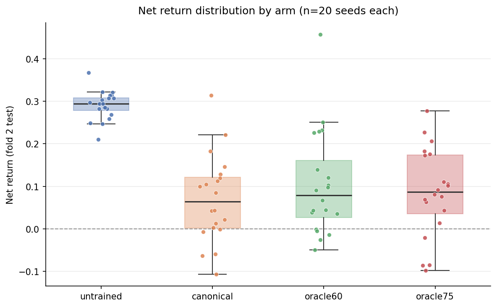

# Hardening session: statistics report

n=20 seeds/arm, from `results/hardening/hardening_results.csv`. alpha=0.05, MDE computed at power=0.8 (not specified in the original spec -- 0.80 is the standard default, stated explicitly here since it changes the MDE numbers).

## Per-arm mean / std / 95% CI (t-based)

| arm | metric | n | mean | std | 95% CI |
|---|---|---|---|---|---|
| canonical | return | 20 | +0.0701 | 0.1023 | [+0.0222, +0.1180] |
| canonical | gross_price_pnl | 20 | +0.4434 | 0.1135 | [+0.3903, +0.4965] |
| untrained | return | 20 | +0.2902 | 0.0335 | [+0.2746, +0.3059] |
| untrained | gross_price_pnl | 20 | +0.5442 | 0.0504 | [+0.5206, +0.5678] |
| oracle60 | return | 20 | +0.1039 | 0.1234 | [+0.0462, +0.1617] |
| oracle60 | gross_price_pnl | 20 | +0.4901 | 0.1406 | [+0.4242, +0.5559] |
| oracle75 | return | 20 | +0.0855 | 0.1048 | [+0.0365, +0.1346] |
| oracle75 | gross_price_pnl | 20 | +0.4677 | 0.1332 | [+0.4054, +0.5301] |

## Mean turnover and transaction cost per arm

| arm | n | mean turnover | std turnover | mean txn_cost | std txn_cost |
|---|---|---|---|---|---|
| canonical | 20 | 0.0120 | 0.0016 | 0.2042 | 0.0321 |
| untrained | 20 | 0.0046 | 0.0007 | 0.0878 | 0.0134 |
| oracle60 | 20 | 0.0126 | 0.0014 | 0.2100 | 0.0292 |
| oracle75 | 20 | 0.0126 | 0.0014 | 0.2144 | 0.0320 |

## Hypothesis tests

### Metric: `return`

| comparison | mean diff (A-B) | Welch t | Welch p | Mann-Whitney U | MW p | conclusion (alpha=0.05) | pooled SD | MDE @ n=20 |
|---|---|---|---|---|---|---|---|---|
| canonical vs untrained | -0.2202 | -9.148 | <0.001 | 18.0 | <0.001 | **reject H0** (both tests p<0.05) | 0.0761 | 0.0692 |
| canonical vs oracle60 | -0.0338 | -0.944 | 0.3514 | 177.0 | 0.5428 | fail to reject H0 (both p>=0.05) | 0.1133 | 0.1030 |
| canonical vs oracle75 | -0.0154 | -0.471 | 0.6405 | 182.0 | 0.6359 | fail to reject H0 (both p>=0.05) | 0.1036 | 0.0941 |
| oracle75 vs oracle60 | -0.0184 | -0.509 | 0.6140 | 197.0 | 0.9461 | fail to reject H0 (both p>=0.05) | 0.1145 | 0.1041 |

### Metric: `gross_price_pnl`

| comparison | mean diff (A-B) | Welch t | Welch p | Mann-Whitney U | MW p | conclusion (alpha=0.05) | pooled SD | MDE @ n=20 |
|---|---|---|---|---|---|---|---|---|
| canonical vs untrained | -0.1008 | -3.627 | 0.0012 | 61.0 | <0.001 | **reject H0** (both tests p<0.05) | 0.0878 | 0.0799 |
| canonical vs oracle60 | -0.0467 | -1.155 | 0.2558 | 172.0 | 0.4570 | fail to reject H0 (both p>=0.05) | 0.1278 | 0.1162 |
| canonical vs oracle75 | -0.0243 | -0.621 | 0.5383 | 175.0 | 0.5075 | fail to reject H0 (both p>=0.05) | 0.1238 | 0.1125 |
| oracle75 vs oracle60 | -0.0223 | -0.516 | 0.6089 | 197.0 | 0.9461 | fail to reject H0 (both p>=0.05) | 0.1370 | 0.1245 |

## Power statement

At n=20/group, alpha=0.05, 80% power, and GIVEN each comparison's own observed pooled standard deviation (exact noncentral-t solution via `statsmodels.stats.power.TTestIndPower`, not the normal approximation), the minimum true difference in means this design could reliably detect ranges **0.069 to 0.125** across the 8 comparison/metric combinations below (see the `MDE @ n=20` column for the exact figure per comparison). A comparison's observed `mean diff` smaller than its own MDE means: even if a real effect of exactly that size existed, this sample size had at best even-odds of detecting it -- the observed non-significance there is uninformative about whether a real, smaller effect exists, not evidence the effect is zero.

## Distribution figure

